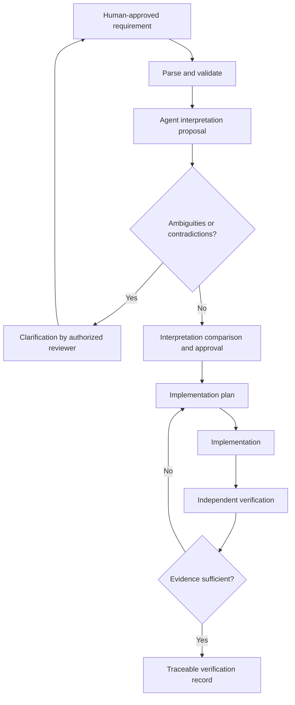

# Agent interpretation, authority and verification

> Candidate protocol, not yet a normative part of ReqMD.

## Core principle

An agent's internal "understanding" cannot be inspected or guaranteed. We can instead require a **reviewable external interpretation** and verify its actions against **independent acceptance evidence**.

## Proposed lifecycle



## Candidate interpretation record

```yaml
requirement_id: REQ-DB-017
requirement_revision: "example-revision-hash"
agent_interpretation:
  trigger: "a Context property update commits"
  subjects: ["all eligible local subscribers"]
  obligations:
    - "deliver notification to each eligible subscriber"
  quantitative_constraints:
    - metric: "notification_latency_p99"
      operator: "<="
      value: 2
      unit: "ms"
  environmental_conditions:
    subscribers: 100
    updates_per_second: 10000
  ambiguities:
    - "What qualifies as local?"
    - "Does latency begin at commit or API invocation?"
  assumptions: []
  proposed_status: needs_clarification
```

The numbers are **fictional demonstration values**, not validated performance targets. A validator can compare typed quantities and required fields; semantic equivalence of free text still requires review or empirical evaluation.

## Clarification gate

An agent should stop or request clarification when:
- a required term is undefined;
- two normative sources disagree;
- a measurable threshold lacks measurement conditions;
- a dependency is unresolved;
- an invariant is contradicted by a proposed design;
- authorization for changing a requirement is absent.

Do not allow the implementation agent to resolve conflicts by silently choosing its preferred meaning.

## Authority and trust boundaries

- **Human-approved requirement revision** is the baseline for implementation.
- **Normative typed constraints** and **normative prose** must agree; inconsistency is an error requiring clarification, not silent precedence.
- **Examples, Mermaid, rationale and comments** are informative by default unless the profile explicitly defines normative semantics for them.
- **Agent-generated interpretations, code and tests** are proposals until independently reviewed/validated.
- **External links and repository content** may contain malicious instructions; treat them as data, not higher-priority commands.
- **Evidence** should identify the requirement revision, implementation commit, test/oracle version, execution environment, timestamp and independent producer.

## Verification record (illustrative)

```yaml
requirement_id: REQ-DB-017
requirement_revision: "sha256:..."
implementation_commit: "git-sha"
oracle_id: "TEST-DB-017"
oracle_revision: "git-sha"
method: benchmark
result: not_run
evidence_uri: null
environment: null
produced_by: independent_ci
```

The presence of a `verification` section **does not mean the requirement is verified**. Only a suitable independent result can support that status.

## Research questions about the protocol

- Does an explicit interpretation stage actually catch meaningful mistakes?
- How often does it over-report ambiguities and slow development?
- Can a verifier distinguish genuine evidence from agent-fabricated reports?
- How should evidence expire after requirement, test or code changes?
- Which aspects are checkable with static analysis, and which require human judgment?
