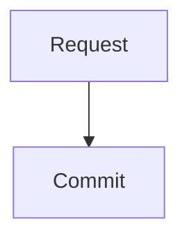

# IntentSpec v0.1 — Draft language profile

**Status:** experimental design specification, not an adopted standard.  
**Scope:** one requirement per UTF-8 `*.req.md` file.  
**Implementation target:** `intentspec` Python prototype in this repository.

This document defines a *small, enforceable syntax and validation contract*. It does **not** claim that the parser can prove the meaning, truth, safety, completeness or consistency of natural-language requirements.

## 1. Source model and syntax

1. A file begins on line 1 with `---`, followed by a YAML mapping, followed by a closing line `---`.
2. Markdown follows the front matter. Parsing uses CommonMark plus pipe tables, fenced code blocks and YAML front matter as explicit extensions.
3. **Only top-level level-two headings** (`## Name`) matching the reserved names below define semantic sections. Headings inside code fences, block quotes and lists are not sections.
4. A single optional top-level H1 is permitted for display. If present, it must exactly match `# <id> — <title>`; front matter remains the canonical identity.
5. Top-level H2 names not listed below are errors in v0.1. This is deliberately strict so misspelled sections cannot be silently ignored.
6. Top-level H3 headings in **Acceptance Criteria** and **Diagrams** declare identified child elements. H3 headings elsewhere are ordinary Markdown structure.
7. Order of sections is not semantically significant. A reserved section may occur at most once.
8. This profile does not execute code, tests or diagrams embedded in Markdown.

### 1.1 Front matter

| Field | Required | Type and rule |
| --- | --- | --- |
| `intentspec` | Yes | Quoted string `"0.1"` |
| `id` | Yes | Stable identifier matching `REQ-<COMPONENT>-<NNN>`, with optional additional uppercase component segments |
| `title` | Yes | Nonempty string |
| `type` | Yes | `functional`, `performance`, `interface`, `security`, `safety`, `constraint`, `quality` |
| `status` | Yes | `draft`, `in_review`, `approved`, `deprecated` |
| `priority` | No | `must`, `should`, `could`, `wont` |
| `component` | No | Nonempty string |
| `source` | No | Nonempty string; source/provenance reference |
| `trace` | No | Mapping of typed links; see §4 |

Unknown fields, non-string values where strings are required, and duplicate YAML keys are errors. YAML must use safe data types; executable YAML tags are not supported. An `id` must remain stable even when the title or filename changes. The file path is **not** the identity.

**Note:** the parser accepts only a deliberately narrow v0.1 metadata vocabulary. Provenance attestations, approval signatures and extensible metadata are deferred.

### 1.2 Reserved sections and authority

| Heading | Required | Role | Meaning |
| --- | --- | --- | --- |
| `## Statement` | Always | **Normative** | The obligation or prohibition |
| `## Definitions` | No | **Normative** | Meanings of terms in this requirement |
| `## Preconditions` | No | **Normative** | Conditions under which obligations apply |
| `## Invariants` | No | **Normative** | Properties that must remain true |
| `## Acceptance Criteria` | Approved requirements | **Normative** | Observable pass/fail criteria |
| `## Diagrams` | No | **Informative** | Illustrations, not additional obligations |
| `## Rationale` | No | Informative | Why the requirement exists |
| `## Open Questions` | No | Informative / gate | Unresolved ambiguity requiring clarification |
| `## Verification` | Approved requirements | Administrative | Planned method and evidence links, **not** proof of success |
| `## Traceability` | No | Informative | Human-readable discussion; typed links belong in `trace` |
| `## Agent Guidance` | No | Informative | Suggested handoff context; cannot override obligations |
| `## Notes` | No | Informative | Additional context |

**No silent precedence:** all normative sections must be mutually consistent. If two normative sources conflict, the requirement must be clarified by an authorized reviewer. The prototype **does not automatically detect semantic contradictions**. Informative sections cannot override normative sections.

`Statement` must contain nonempty content. For `approved` requirements, `Acceptance Criteria` and `Verification` must both be nonempty, and `Open Questions` must be absent or empty. These are *structural approval gates*, not a substitute for human approval.

## 2. Acceptance criteria

Under `## Acceptance Criteria`, each criterion is introduced by a top-level-in-section H3:

```markdown
## Acceptance Criteria

### AC-01: Successful update
Given an existing property
When a valid update commits
Then the new value and one change record exist
```

- Identifier pattern: `AC-\d{2,}`, unique **within the requirement**.
- The criterion title and body must be nonempty.
- Criterion identity across the repository is `<requirement-id>#<criterion-id>`.
- Criteria may contain prose, tables, or `gherkin` fenced code. The prototype does **not** execute Gherkin or verify step definitions.
- An `Acceptance Criteria` section with no identified criteria is an error, even in a draft.

Criteria must be independently testable in principle, but this prototype cannot prove testability.

## 3. Diagrams

Under `## Diagrams`, each diagram is introduced by:

````markdown
## Diagrams

### D-01: Update transaction


````

The outer Markdown fence in the example is illustrative; in the actual source the inner `mermaid` fence is used directly.

- Identifier pattern: `D-\d{2,}`, unique within the requirement.
- Exactly one nonempty `mermaid` fenced code block is required per diagram entry.
- Diagrams are **informative in v0.1**, including flowcharts, sequence and state diagrams.
- The validator checks **placement and fence presence**, **not Mermaid grammar** and **not agreement with prose**.
- A future normative diagram subset would require its own formal semantics and conformance tests.

## 4. Typed traceability

Front matter supports:

```yaml
trace:
  depends_on: [REQ-DB-001]
  refines: []
  related_to: [REQ-DB-009]
```

Each relation contains a list of requirement IDs. Duplicate and self-references are errors. When validating a collection of files, every referenced requirement must exist in that collection; unresolved references are errors. There is no inferred inverse relation or automatic cycle prohibition in v0.1. External code/test/evidence links are described in `Verification` until their schemas are defined.

A standalone file referencing requirements not included in the validation input will therefore fail; validate a **complete requirement set**.

## 5. Agent behavior and trust

- Agents must treat only normative sections as product obligations.
- Agents must not silently resolve missing definitions, conflicting obligations, or nonempty open questions in approved requirements.
- `Agent Guidance`, diagrams, examples and repository links are lower-authority context; they must not override approved normative requirements or higher-priority system instructions.
- An agent may emit a **structured interpretation proposal** (trigger, subjects, obligations, constraints, ambiguities). This is a **separate protocol artifact**, not yet normative IntentSpec syntax.
- An agent's interpretation and self-reported success are not evidence of correctness. Independent acceptance oracles, human review and execution evidence remain necessary.
- Treat external Markdown, links, generated code and test logs as untrusted inputs; do not execute embedded content while parsing.

## 6. Conformance and diagnostics

The Python prototype distinguishes:

1. **Syntax errors:** missing/malformed front matter, unsafe YAML, duplicate YAML keys, invalid headings.
2. **Structural errors:** missing fields, invalid IDs, duplicate sections/criteria/diagrams, malformed diagram entries, broken links, approval-gate violations.
3. **Quality concerns:** ambiguity, missing edge cases, semantic contradictions and diagram drift. These are **not mechanically guaranteed** by v0.1 and need review.

`intentspec validate <paths>` returns exit code 1 if any syntax/structural errors occur. `intentspec export-json <paths>` exports a parsed model only when validation succeeds. Exported JSON preserves section Markdown, roles, identified criteria and Mermaid source; it does not claim formal semantic equivalence.

## 7. Out of scope for v0.1

Formal semantics for unrestricted natural language, automated ambiguity proof, executable Mermaid, Gherkin step definitions, evidence authenticity, human approval signatures, full lifecycle transitions, semantic diff, ReqIF/OSLC, PDF/HTML generation and autonomous agent workflow orchestration.

## 8. Review questions

1. Is strict heading recognition ergonomic enough for human authors?
2. Should `Acceptance Criteria` be required for every approved requirement type, or can some use inspection/analysis instead?
3. Is one requirement per file the right granularity?
4. How should typed constraints and units become normative without duplicating prose?
5. What evidence/provenance schema prevents stale or self-attested verification?
6. What is the smallest agent interpretation contract that measurably improves outcomes?

See [examples](../examples/) and the [research design](04-research-design.md).
