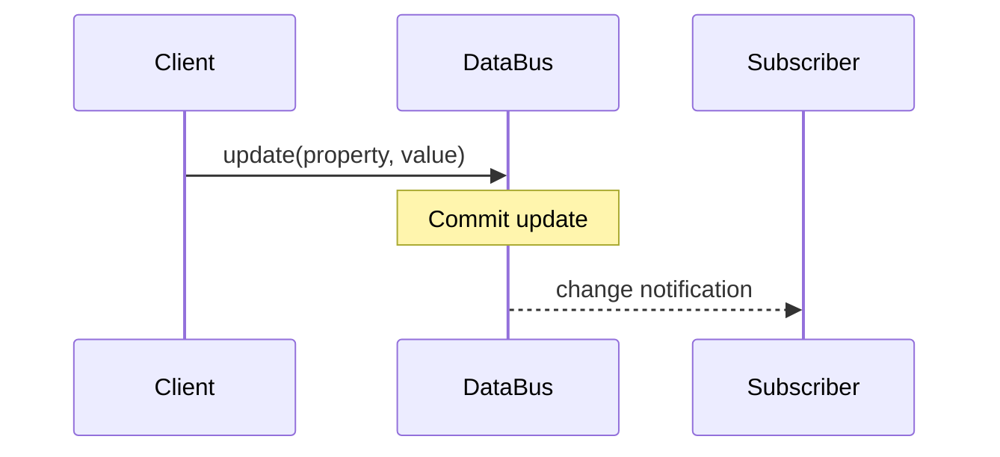

# REQ-DB-017 — Context change notification

## Statement

When a Context property update commits, the DataBus **SHALL** notify each eligible local subscriber of the changed property.

Under the specified benchmark workload, the **99th percentile notification latency SHALL be at most 2 ms**.

## Definitions

- **Local subscriber:** UNDEFINED — requires clarification before approval.
- **Notification latency:** proposed start at update commit and end at notification receipt; confirmation required.

## Preconditions

- The subscriber is registered for the property.
- The property update commits successfully.

## Diagrams

### D-01: Notification interaction

This diagram is informative.

## Acceptance Criteria

### AC-01: Notify subscribed client

Given an eligible local subscriber registered for a property, when the property update commits, then the subscriber receives a notification of the changed property.

### AC-02: Benchmark latency

Under a benchmark with 100 local subscribers and 10,000 property updates per second, the p99 notification latency shall not exceed 2 ms.

## Rationale

Low-latency notifications may be needed by local control components; this rationale has not been confirmed by a stakeholder.

## Open Questions

- What exactly qualifies as a *local* subscriber?
- Are notifications guaranteed to be delivered, or best effort?
- How are ordering, disconnections, and backpressure handled?
- Which hardware, runtime and measurement method define the benchmark?

## Verification

**Planned method:** integration test and benchmark. No independent tests or evidence exist yet.

## Traceability

Dependencies and test links will be assigned after clarification. Earlier placeholder IDs are intentionally omitted from typed traceability so this draft can be structurally valid.

## Agent Guidance

The agent must request clarification on the meaning of local subscriber and delivery semantics before implementing this draft as an approved requirement.
