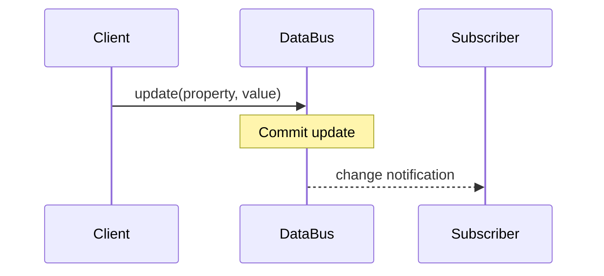

# REQ-DB-017 — Context change notification

> **Fictional example, not an approved product requirement.** Referenced IDs are illustrative and intentionally unresolved.

## Requirement

When a Context property update commits, the DataBus **SHALL** notify each eligible local subscriber of the changed property.

Under the stated benchmark conditions, the **99th percentile notification latency SHALL be at most 2 ms**.

## Terms and measurement

- **Local subscriber:** UNDEFINED — requires clarification before implementation.
- **Latency start:** the commit point of the property update (proposed).
- **Latency end:** receipt of the notification by a subscriber (proposed).
- **Measurement population:** notifications for eligible subscribers under the specified benchmark workload.

## Conditions

| Parameter | Illustrative value |
| --- | ---: |
| Local subscribers | 100 |
| Property updates per second | 10,000 |
| p99 notification latency | <= 2 ms |

## Rationale

Low-latency notification may be needed by local control components. This rationale must be confirmed by a stakeholder.

## Behavior diagram



> Diagram is **informative** in this draft; prose and approved typed constraints would be normative.

## Acceptance criteria

```gherkin
Feature: Context change notification
  Scenario: Notify an eligible subscriber after an update
    Given an eligible local subscriber is subscribed to a Context property
    When an update to the property commits
    Then the subscriber receives a notification of the changed property
```

- **Positive:** all eligible subscribers receive the notification.
- **Negative:** ineligible or unsubscribed clients do not receive it.
- **Boundary:** p99 latency is at most 2 ms under the benchmark conditions.
- **Unresolved:** define eligibility, failure handling, notification ordering and benchmark hardware.

## Verification

- **Method:** benchmark + automated functional tests.
- **Oracle:** independent test suite `TEST-DB-017` (not yet implemented).
- **Evidence:** not available.
- **Result:** not run.

## Assumptions and questions

1. What exactly qualifies as a *local* subscriber?
2. Is notification ordering guaranteed for rapid successive updates?
3. What happens when a subscriber is slow or disconnects?
4. Does "each" imply delivery guarantees or best-effort delivery?
5. Which machine, runtime and measurement methodology define the benchmark?

## Traceability

- Depends on: `REQ-DB-003` (placeholder)
- Verified by: `TEST-DB-017` (placeholder)
- Implementation: not assigned

## Agent interpretation gate

The agent **must request clarification** on the undefined term "local subscriber" and delivery semantics before treating this requirement as implementable.
