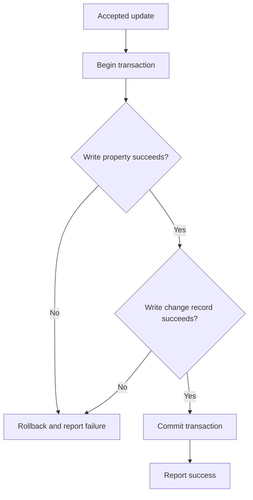

# REQ-DB-018 — Atomic property update with change record

## Statement

For each authorized, valid request to update an existing Context property, the DataBus **SHALL** commit the new property value and exactly one corresponding change record in the **same atomic storage transaction**.

The DataBus **SHALL** report success only after that transaction commits.

If either write fails, the DataBus **SHALL** roll back the transaction and report failure, leaving the previous property value and change history unchanged.

## Definitions

- **Accepted request:** a single request that has passed authorization and input validation.
- **Change record:** a persisted record containing the property ID, previous value, and new value.
- **Atomic transaction:** either both writes commit or neither write commits.
- **No-op update:** a valid request whose new value equals the stored value; it is still an accepted update and creates one change record.

## Preconditions

- The property exists.
- The caller is authorized.
- The submitted value passes validation.
- The property value and change history share a storage mechanism supporting atomic transactions.

## Invariants

- No successful accepted request exists without its change record.
- No change record is committed for a failed accepted request.
- Every successful accepted request produces exactly one change record.
- These obligations apply **per accepted request**; deduplication of distinct network retries is outside this requirement.

## Diagrams

### D-01: Atomic update transaction

The diagram is informative; the Statement and Invariants are normative.

## Acceptance Criteria

### AC-01: Both writes succeed

Given an accepted request and functioning storage, when the update is committed, then the new value and exactly one matching change record are persisted and success is reported.

### AC-02: Property write fails

Given an accepted request, when the property write fails, then the previous property value and change history remain unchanged and failure is reported.

### AC-03: Change record write fails

Given an accepted request, when the change-record write fails, then the previous property value and change history remain unchanged and failure is reported.

### AC-04: Same-value update

Given an accepted request whose new value equals the current value, when the transaction succeeds, then exactly one change record is persisted.

### AC-05: No premature success

Given an accepted request, when the transaction has not yet committed, then the DataBus has not reported success.

## Verification

**Planned method:** integration tests with fault injection at both storage writes and the commit boundary.

**Independent oracle:** compare the persisted value and change history before and after each request. Verify the response timing relative to commit.

**Current evidence:** none; not run. The document status is **in_review**, not verified.

## Agent Guidance

Implement the approved transaction semantics only after stakeholder review. Do not infer cross-request idempotency, concurrency ordering, or distributed transaction behavior from the diagram. A generated test suite alone does not constitute independent verification.

## Notes

This is a **fictional example** for discussing language design, not a stakeholder-approved product specification. Concurrency ordering and retry idempotency are separate requirements if needed.
